# Jadwal - جدول 📅🚀
> **منظومة التنسيق الذكي للجداول الجامعية لطلاب الجامعات الأردنية**  
> *Smart Course-Registration & Timetable Optimization Platform for Jordanian University Students*

[](https://nestjs.com/)
[](https://react.dev/)
[](https://flutter.dev/)
[](https://www.typescriptlang.org/)
[](https://sqlite.org/)

---

## 📖 نظرة عامة على المشروع (Project Overview)
**جدول (Jadwal)** هو حل تقني متكامل لمعضلة تسجيل المواد وإعداد الجداول الفصلية في الجامعات الأردنية. يقوم النظام باستبدال الطرق التقليدية المجهدة (الورق والقلم، مجموعات الواتساب، التنسيق اليدوي) بخوارزميات ذكاء اصطناعي وبحث عكسي (Backtracking Search) لإيجاد كل الجداول الممكنة الخالية من أي تعارض بنسبة 100% مع مراعاة كافة تفضيلات الطالب (تقليل ساعات الفراغ، تفضيل أيام معينة، تجنب الساعات المبكرة أو المتأخرة، وتحديد المدرسين المفضلين).

النظام مبني بهيكلية **Monorepo** يضم:
1. **الواجهة الرئيسية للطلاب (Web Portal):** واجهة ويب سريعة جداً ومبنية بـ React 19 + TypeScript.
2. **تطبيق الهاتف الذكي (Mobile App):** تطبيق Flutter عصري بتصميم جذاب ومريح للعين مع تجربة استخدام سلسة.
3. **محرك الخوارزميات والخادم (NestJS Backend):** خادم REST API قوي يقوم بحساب التباديل والتعارضات وتصدير ملفات التقويم iCal / ICS ومشاركة الروابط.
4. **لوحة تحكم الإدارة (Admin Dashboard):** لوحة تحكم متكاملة لمتابعة إحصائيات الاستخدام، إدارة الجامعات، والفصول الدراسية، والكتالوجات.

---

## 📸 معرض صور وشاشات المشروع (Screenshots Gallery)

### أولاً: تطبيق الويب ومنصة الطلاب (Web Application)

| 01. الصفحة الرئيسية والبحث عن المواد | 02. اختيار المواد وتحديد الساعات |
| :---: | :---: |
| 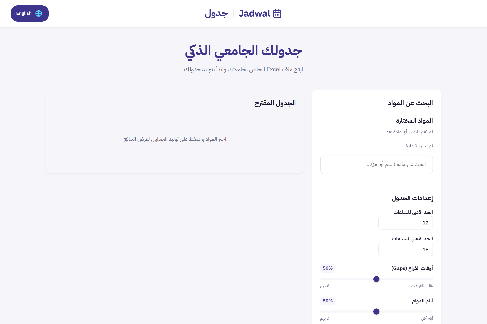 | 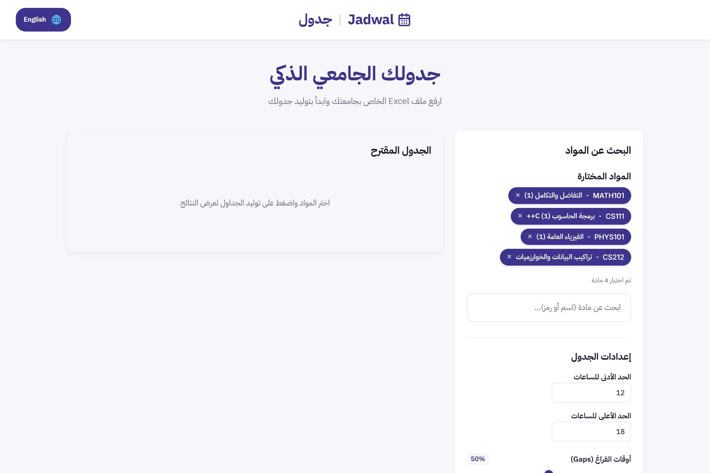 |

| 03. الجدول المقترح المولد بدون تعارضات | 04. صفحة الجدول المشترك ومشاركته مع الزملاء |
| :---: | :---: |
| 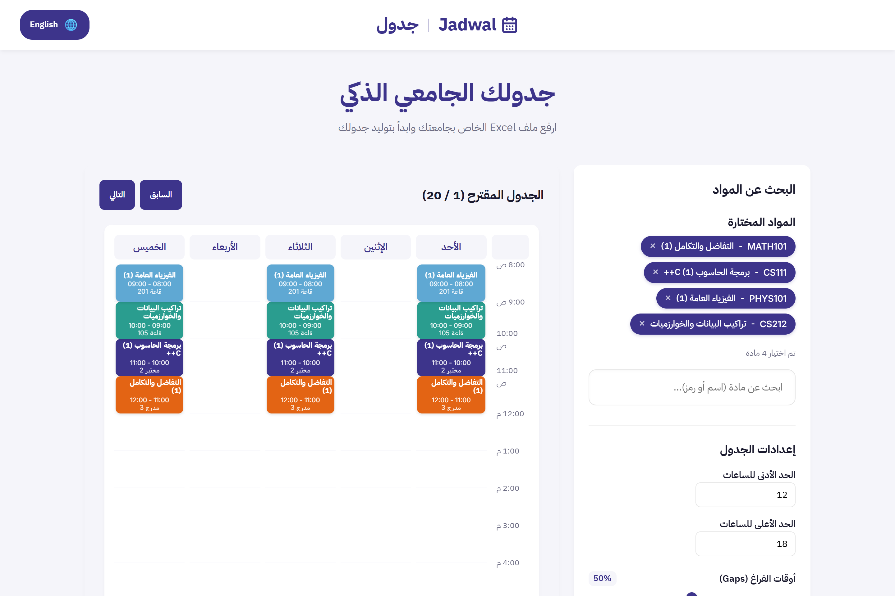 | 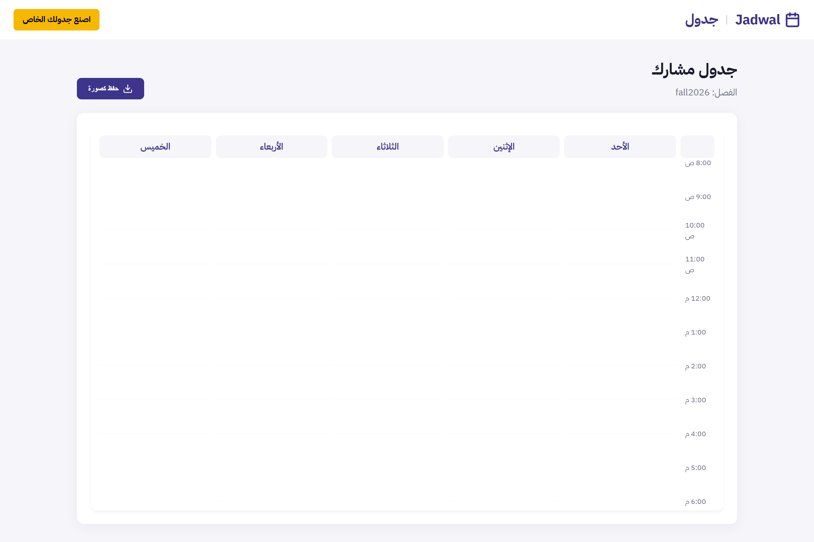 |

---

### ثانياً: لوحة تحكم الإدارة (Admin Dashboard)

| 05. بوابة تسجيل دخول المشرف | 06. لوحة الإحصائيات وسجل النشاط اللحظي |
| :---: | :---: |
| 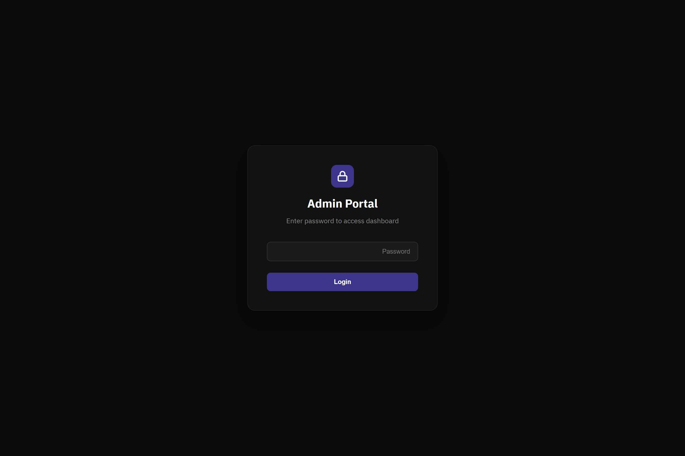 | 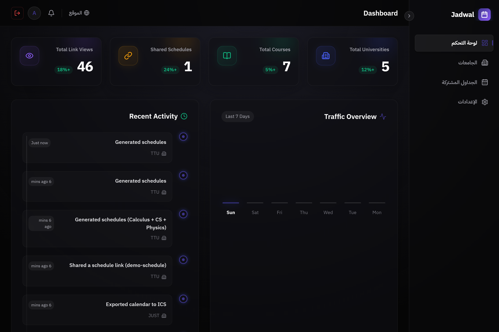 |

| 07. إدارة الجامعات والكتالوجات | 08. متابعة الجداول المشتركة والزيارات |
| :---: | :---: |
| 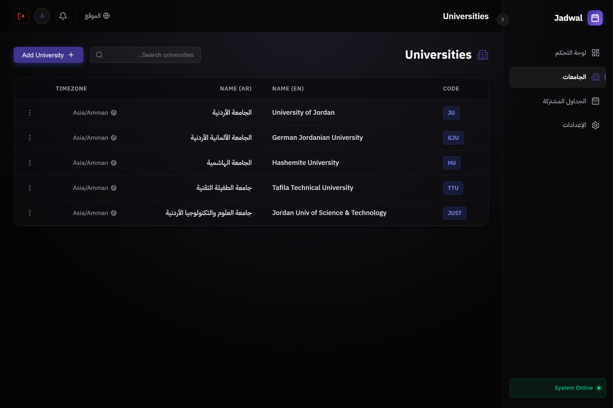 | 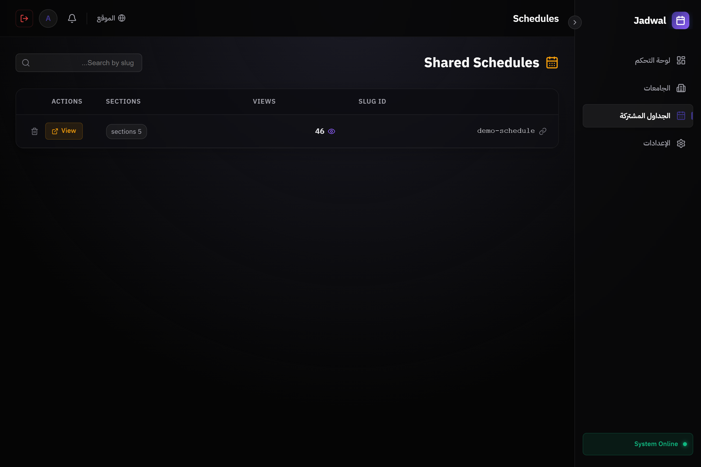 |

| 09. إعدادات النظام ومعايير الخوارزمية |
| :---: |
| 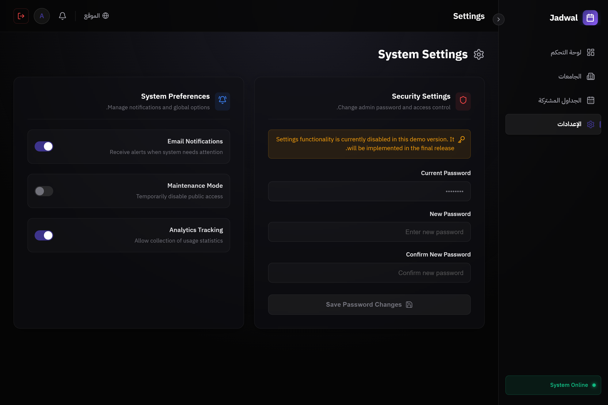 |

---

### ثالثاً: تطبيق الموبايل (Flutter Mobile Application)

| 10. شاشة الترحيب واختيار الجامعة | 11. اختيار المواد والحد المعتمد |
| :---: | :---: |
| 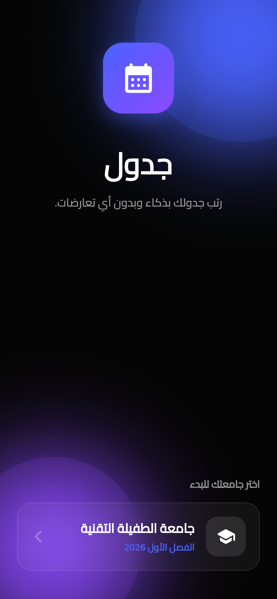 | 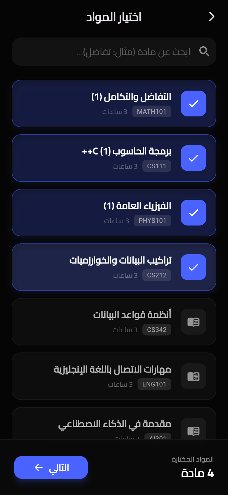 |

| 12. تفضيلات الذكاء الاصطناعي والأوقات المحظورة | 13. النتائج الذكية والجداول المبتكرة |
| :---: | :---: |
| 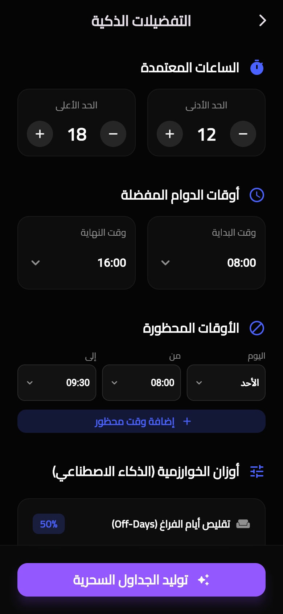 | 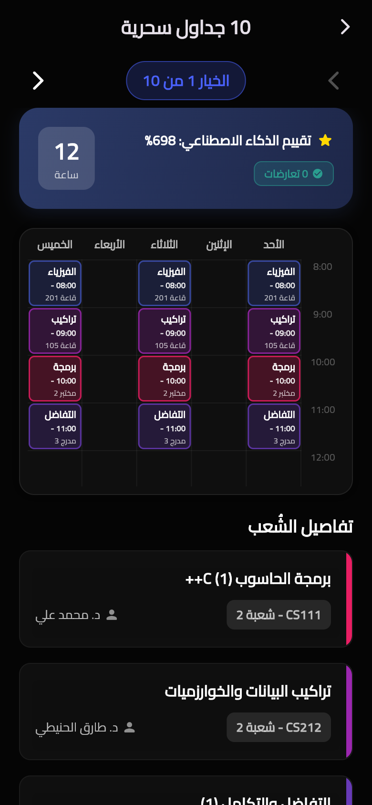 |

---

## 🛠️ البنية التقنية (Technology Stack)

- **Backend:** [NestJS](https://nestjs.com/) (Node.js framework), TypeORM, Better-SQLite3, Multer, XLSX parser.
- **Frontend (Web):** [React 19](https://react.dev/), [TypeScript](https://www.typescriptlang.org/), [Vite](https://vitejs.dev/), Lucide Icons, html2canvas.
- **Mobile:** [Flutter 3](https://flutter.dev/) (Dart), Provider for State Management, Google Fonts Cairo.
- **Architecture:** Monorepo (`apps/api`, `apps/web`, `apps/mobile`).

---

## ⚡ التشغيل السريع (Quick Start)

### الطريقة السريعة بنقرة واحدة (Windows Direct Launch):
1. **لتشغيل الموقع والخادم ولوحة التحكم:**
   - انقر نقراً مزدوجاً على الملف: `RUN_DASHBOARD.bat`
   - الرابط العام للموقع: `http://localhost:5173`
   - رابط لوحة تحكم المشرف: `http://localhost:5173/admin`  
     *(كلمة المرور الافتراضية: `admin123`)*

2. **لتشغيل تطبيق الموبايل:**
   - انقر نقراً مزدوجاً على الملف: `RUN_MOBILE.bat`
   - سيعمل التطبيق على الرابط: `http://localhost:5000`

---

## 💻 التشغيل اليدوي عبر سطر الأوامر (Manual Setup)

```bash
# 1. تثبيت الحزم والمكتبات
npm install

# 2. بناء وتشغيل الخادم الخلفي (API Server)
npm run start:dev --workspace=api

# 3. تشغيل واجهة الويب (Web App)
npm run dev --workspace=web

# 4. تشغيل تطبيق الهاتف (Mobile App via Flutter)
cd apps/mobile
flutter pub get
flutter run -d chrome
```

---

## 🔐 بيانات المشرف (Admin Credentials)
- **رابط الدخول:** `http://localhost:5173/admin/login`
- **اسم المستخدم:** `admin`
- **كلمة المرور:** `admin123`
